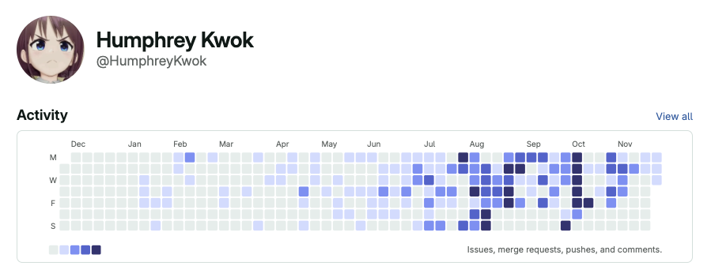

# Humphrey "Hinzik" Kwok

Software Engineer | DevOps Engineer · Hong Kong

I build applied-AI orchestration, frontend infrastructure, and Kubernetes platforms. Most of my work is for the public and finance sectors, so it is not publicly visible. Anonymised summaries are on [hinzik.dev](https://www.hinzik.dev/).

- **Applied AI**: agent orchestration, RAG pipelines, ASR integration
- **Frontend**: React, GSAP, Motion, Figma
- **Backend**: TypeScript, oRPC, PostgreSQL
- **Platform**: Linux, Docker, Kubernetes, Helm, Istio, LGTM, AWS
- **Hardware**: mechanical keyboard design with KiCad, Fusion 360, and KeyShot

[hinzik.dev](https://www.hinzik.dev/) · [LinkedIn](https://www.linkedin.com/in/humphreykwok/) · [contact@hinzik.dev](mailto:contact@hinzik.dev)

If you wonder where have my contributions gone, meanwhile my working gitlab...

